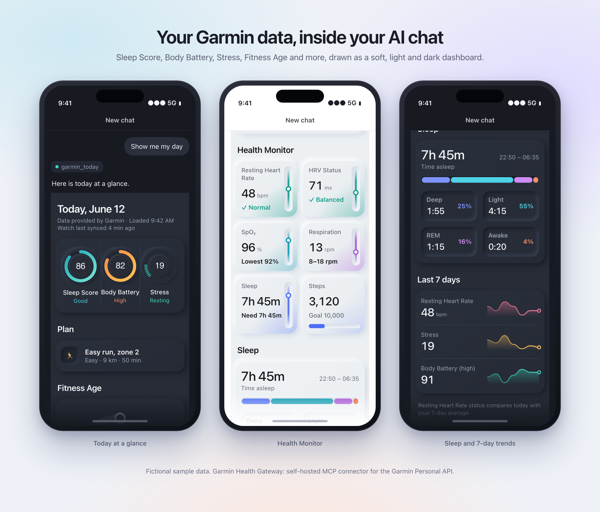

# Garmin Health Gateway

Your Garmin data, in any AI app. A small self-hosted gateway that turns your
[Garmin Personal API](https://developer.garmin.com/gc-developer-program/personal/personal-api/)
key into:

- **an MCP connector** for Claude (web, desktop, mobile), ChatGPT, Cursor and other MCP clients
- **a REST API** for iOS Shortcuts, scripts, bots and dashboards

It runs on your own Cloudflare account, on the free tier. Your key stays in Cloudflare's
encrypted secrets, and your health data goes from Garmin to your Worker to your AI app.
No third party sits in between. The only things kept are in your own Cloudflare KV: your goal and plan if you use the goal coach, and a short-lived copy of the dashboard snapshot (3 days) so the widget loads fast.

<p align="center">
  
</p>

<sub>Fictional sample data. Dark-only and light-only versions: `docs/images/widget-mockup-dark.png` and `widget-mockup-light.png`. Regenerate them from `docs/mockup/index.html` (serve the repo root, open the page, optional `?mode=dark|light`).</sub>

> Unofficial project, not affiliated with Garmin. Endpoint routes follow Garmin's official
> [`garmin-connect-personal-api-python`](https://github.com/garmin/connect-personal-api-python) client.

## What you can ask

- "How did this morning's run go?" (splits, HR drift, cadence, running dynamics)
- "Am I recovered enough for intervals today?" (sleep, HRV vs baseline, Body Battery, resting HR)
- "Is my weekly mileage ramping too fast?" (weekly km, long run, ramp %)

## Tools

| Tool | What it returns |
|---|---|
| `list_activities` | Recent activities: distance, pace, HR, cadence, training effect and load, dynamics |
| `analyze_activity` | One activity in depth. With FIT analysis on: per-km splits, laps, aerobic decoupling, running dynamics, time in HR zones |
| `training_load` | Weekly running km, hours, long run, week-over-week ramp % |
| `daily_wellness` | Sleep, HRV, Body Battery, resting HR, stress for one day |
| `wellness_trend` | The same as a daily trend over a range (handles Garmin's per-request limits) |
| `profile_and_zones` | Profile settings and Garmin HR zones |
| `athlete_baseline` | Weekly km, runs per week, longest run, easy pace and HR, best efforts, VO2max, resting HR, HRV baseline |
| `set_goal`, `get_goal` | Store and read your training goal (needs the KV namespace, see Goal coach) |
| `save_plan`, `get_plan`, `update_plan` | Store a periodized plan, read a week, patch days with a logged reason; 20 versions kept |
| `get_today`, `plan_progress` | Today's session with recovery data and yesterday's check; planned vs done per week |
| `get_routine` | Mobility and strength routines (IT band hip work, runner core, warm-up, foam rolling) |
| `garmin_today` | Today at a glance with a dashboard widget: Sleep Score, Body Battery, Stress, HRV Status, Resting Heart Rate, SpO2, Respiration, Steps, Fitness Age, 7-day trend, today's planned session |
| `fitness_age` | Garmin Fitness Age with the factors behind it |
| `get_activity`, `garmin_raw_get` | Raw activity JSON, and an allowlisted read-only escape hatch |

## Costs

| What | Cost |
|---|---|
| Hosting on Cloudflare Workers free tier | **Free** |
| FIT-file analysis (splits, decoupling, zone times) | Workers Paid, **$5/month**. Parsing a 50-minute run takes about 70 ms CPU; the free plan allows 10 ms per request. Without it you get Garmin's summary data. |
| Using the connector in Claude, including a daily scheduled report | **Included in your Claude plan.** No API key needed; counts toward your plan's usage limits. |
| Using it in ChatGPT or other apps | Whatever that app's plan includes |

## Setup (about 10 minutes)

You need Node 20+, a free [Cloudflare](https://dash.cloudflare.com/sign-up) account, and a
Garmin Personal API key (Garmin Connect web → Personal API → Create Key; it's shown once).

```bash
git clone https://github.com/<you>/garmin-health-gateway
cd garmin-health-gateway
npm install
npx wrangler login

npx wrangler secret put GARMIN_API_KEY   # paste your Garmin key
openssl rand -hex 24                     # copy the output
npx wrangler secret put GATEWAY_SECRET   # paste that random string

npx wrangler deploy
```

`deploy` prints your Worker URL, e.g. `https://garmin-health-gateway.<you>.workers.dev`.

**Treat every URL that contains `GATEWAY_SECRET` like a password.** If one leaks, set a new
secret with `npx wrangler secret put GATEWAY_SECRET`; old URLs stop working immediately.

### Configure (optional)

Edit `[vars]` in `wrangler.toml`, then `npx wrangler deploy`:

| Var | Default | Meaning |
|---|---|---|
| `TIMEZONE` | `Europe/Ljubljana` | Your IANA time zone; decides what "today" means |
| `HR_ZONES` | empty | Upper HR bound of zones 1-4, e.g. `130,145,160,172`, for time in zones |
| `ENABLE_FIT_ANALYSIS` | `false` | `true` on Workers Paid for FIT-level analysis |

## Connect it

### Claude

Settings → Connectors → Add custom connector, and paste:

```
https://garmin-health-gateway.<you>.workers.dev/mcp/<GATEWAY_SECRET>
```

No OAuth step. It now works in every Claude chat, on mobile too.

### ChatGPT

Add the same URL as a custom MCP connector (available with developer mode enabled in ChatGPT's connector settings).

### REST

```bash
# today's recovery
curl https://<worker>/api/<GATEWAY_SECRET>/today

# or keep the secret out of the URL
curl -H "Authorization: Bearer <GATEWAY_SECRET>" "https://<worker>/api/load?weeks=8"
```

Routes: `/api/tools` (list with JSON schemas), `/api/<tool_name>`, and the aliases
`today`, `latest-run`, `load`, `trend`, `activities`. Arguments go in the query string
(`?date=2026-10-22&limit=5`) or as a JSON body with POST.

## Dashboard widget

`garmin_today` renders as a card dashboard in clients that support MCP Apps (Claude does). It
follows the app's light or dark theme, uses Garmin's own names for every metric, and only shows
what Garmin returns. Training Readiness, Training Status and Endurance Score are not exposed by
Garmin's Personal API, so they are not shown. Ask "show me my day" in a chat with the connector.

## Goal coach

Say "I want to run a half marathon next year", or pick the `plan_goal` prompt in Claude. Claude reads
your Garmin baseline, interviews you one or two questions at a time, saves your goal and a
periodized plan in your Worker, and from then on adapts it to your sleep and HRV. The `today` prompt
gives a go, adjust or rest verdict. Needs a one-time KV namespace (free tier):

```bash
npx wrangler kv namespace create STATE
```

Uncomment the `[[kv_namespaces]]` block at the end of `wrangler.toml`, paste the id, then
`npx wrangler deploy`. The plan stays in your Cloudflare account. The gateway can't push workouts
to your watch (the Personal API is read-only), so the plan lives in the chat and in `get_today`.
Not medical advice; for pain that changes your gait or gets worse, see a physio.

## Daily morning report in Claude (free with your plan)

Ask Claude in any chat with the connector enabled:

> Every morning at 7:30, check my Garmin data (use get_today if I have a plan) and send me a recovery report, including today's planned session: last night's
> sleep, HRV against my baseline, Body Battery, resting HR, yesterday's training and this
> week's load, and a clear verdict on whether today should be hard, easy or rest.

Claude creates a scheduled task and sends you a push notification when each report is ready.
If your watch hasn't synced last night's sleep by then, the report says so.

## Roadmap

- Telegram bot: chat with Claude about your data and get the morning report in Telegram (uses your own Anthropic API key, a cent or two per message)
- iMessage relay for an always-on Mac
- Template report with no AI at all (free, numbers only)

## Development

```bash
npm test         # runs the Worker locally against a mock Garmin API (synthetic 10 km FIT run)
npm run typecheck
```

## License

MIT
